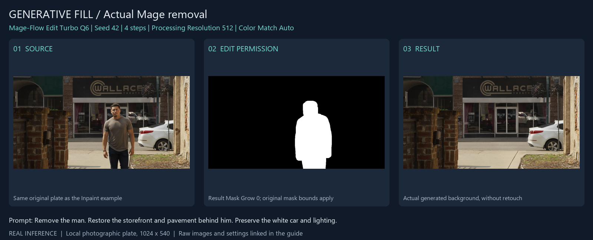
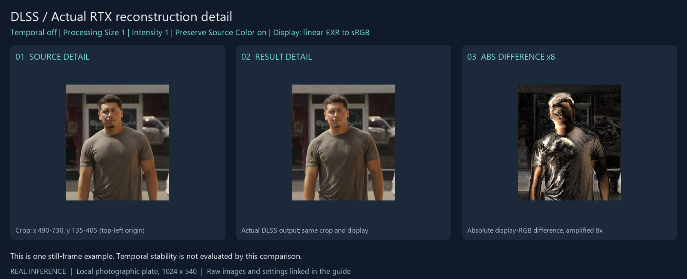

<h1><a href="https://github.com/vaaleerkiin/Kyven"></a>&nbsp;Kyven Tools</h1>

**Local AI tools for Foundry Nuke: object mattes, soft alpha, object removal, generative edits, optical flow and RTX neural reconstruction.**

[Website](https://vaaleerkiin.github.io/Kyven/) · [Choose a tool](#real-examples) · [Combine the tools](#combine-the-tools) · [Install](#start-here) · [Documentation](docs/README.md)

**Status:** active pre-alpha, developed primarily for Nuke on Windows. Inference
stays on your workstation. Five nodes use a shared local server; standalone WAFT
runs through Nuke's native Inference nodes.

## Real examples

Choose the node that matches your compositing task. Each example below uses the
same photographic plate and actual model output, with no result retouching.
[Capture notes](docs/EXAMPLES.md) include full-size results, masks and settings.

### Segment — create an object matte

**Use it for** isolating a person, vehicle or prop for roto, selective grading,
compositing or an object-removal mask. Positive points identify the subject;
negative points exclude unwanted regions. SAM 2 tracking can propagate that
selection through a shot, with correction frames where needed.


**In this example:** five positive points select the person. The middle panel
shows the actual binary alpha; the right panel uses it to cut the person out of
Source. **Source + Alpha** keeps the original RGB visible and adds the matte in
alpha, so inspect **Alpha** or **Cutout** to judge the selection.

**Start:** connect Source, choose SAM 2.1 Small, place points and click **Process
Current Frame**. Use the alpha as your mask, or send it with original Source to
**Refine** when the edge needs soft coverage.

[Segment guide: prompts, tracking and outputs](docs/SEGMENT.md)

### Refine — improve an existing matte's edges

**Use it for** hair, soft contours and partial transparency when a coarse mask
already identifies the subject. Source RGB supplies the edge detail; the trimap
marks known foreground, known background and the gray region to solve. Start
with a Segment, keyer or painted alpha.


**In this example:** ViTMatte Small refines the Segment silhouette around the
person's head and sleeves. The same detail crop shows Source, the generated
trimap and the actual soft alpha. Settings are erosion 5 px, dilation 8 px and
512 px tiles. The result is an alpha matte for compositing.

**Start:** connect original Source and Mask alpha, inspect **Trimap**, then
**Process Current Frame**. **Source + Refined Alpha** carries the matte;
**Refined Cutout** applies it to RGB. If Segment supplies **Edge Guide**, turn
**Generate Trimap from Mask** off. Range frames are solved independently.

[Refine guide: trimaps, tiling and alpha integration](docs/REFINE.md)

### Inpaint — paint out unwanted content

**Use it for** removing wires, small props, distracting objects or other marked
content when the surrounding image provides the background context. LaMa fills
the masked region without a text prompt. A tight crop with enough context is a
useful starting point for clean-up work.


**In this example:** Big-LaMa Native removes the person using the Segment
silhouette grown by 14 px. It estimates the hidden shopfront and pavement.
The published result includes the remaining artifacts near the bottom edge;
inspect reconstructed lines and texture before accepting a repair.

**Start:** connect Source and a white removal Mask in alpha, check **Preview
Model Mask**, then **Process Current Frame**. Use **Result** for the clean-up
or **Generated Patch** for your own composite. Big-LaMa Native retains native
crop detail; LaMa ONNX Fast is the CPU/live-preview option. Each frame is
processed independently, so sequences can show texture variation.

[Inpaint guide: models, masks and compositing](docs/INPAINT.md)

### Generative Fill — direct an edit with text

**Use it for** adding a prop, replacing an object, changing clothing or materials,
or removing content with an explicit description of the intended replacement.
The prompt describes the edit; the alpha mask controls where RGB may change.
Mage is the factory default, with FLUX alternatives available.



**In this example:** Mage receives the same removal mask as Inpaint and an
instruction to remove the man and restore the storefront and pavement. The
result uses a 512 px working side, four steps and seed 42. Source pixels outside
the permission mask were verified unchanged. Compare the two removal examples
to see how their background estimates differ.

**Start:** connect Source and Mask alpha, enter Prompt, use **Install / Repair
Model** on first use, then **Generate Current Frame**. Keep **Grow / Erode 0** and **Mask Blur 0** for the original mask boundary. **Result** preserves Source alpha and other
channels; **Generated Patch** supports an external composite. Test a frame
before a range: a fixed seed does not provide temporal consistency.

After one generation, tune **Color Match Strength**, **Match Luminance**, **Match
Chroma**, **Grow / Erode** and **Mask Blur** live in Nuke. **Preview Blend Mask** shows
the final blend alpha. Result mask controls run after generation and leave the model mask unchanged. Processing Resolution is a dropdown up to **2048** for Mage.
Use a normal Write on the Group to save the adjusted look.

[Generative Fill guide: prompts, masks and outputs](docs/GENERATIVE_FILL.md) · [Mage setup](docs/MAGE_FILL.md)

### DLSS — try neural RGB reconstruction on RTX

**Use it for** exploring neural changes to image detail and appearance on an RTX
system, then adjusting their contribution with **Intensity**. Use a mask guide
to focus processing and **Preserve Source Color** to retain Source RGB ratios.
Compare representative shot details before committing to a range.



**In this example:** an actual RTX still-frame render changes detail on the
person's face and clothing. Source and Result use the same crop and display
transform; the third panel amplifies the absolute display-RGB difference by 8.
Temporal is off. These visible changes need artistic review; the output remains
at Source resolution with Source alpha and auxiliary channels preserved.

**Start:** install **Kyven DLSS Runtime**, connect Source and **Process Current
Frame**. For temporal correction across a shot, connect valid current-to-previous
Motion, check its channels and units, enable Temporal and process forward.
DLSS requires Windows and NVIDIA RTX; it has no CPU inference provider.

[DLSS guide: reconstruction, mask guides and temporal setup](docs/DLSS.md)

### WAFT SmartVector — generate motion for other nodes

**Use it for** estimating movement between adjacent frames. Choose **Motion
Vectors** for consumers such as **VectorBlur**, or **Smart Vectors** for
surface-following warps and projections with **VectorDistort**. WAFT produces
vector channels that downstream nodes use to follow the shot's motion.


**In this example:** Nuke pans the real photograph by 8 px per frame. Native
WAFT measures a median **8.01 px horizontal** displacement and approximately
zero vertical displacement. The final panel visualizes the actual forward flow:
hue encodes direction and brightness encodes magnitude. This controlled test
does not establish performance on moving subjects, deformation or occlusion.

**Start:** connect a sequence, choose Output Mode and render with an ordinary
**Write: EXR, channels = all**. Copy vector layers into a Source branch when a
downstream node needs both RGB and vectors. WAFT is a standalone Nuke 16 Cattery
plugin with embedded FP16/FP32 models; it needs no Kyven Server or Model Manager.
Its backward vectors can also feed DLSS after verifying direction, channels and
units for that shot.

[WAFT guide: output channels and downstream use](docs/WAFT.md) · [Standalone packaging](plugins/README.md)

## Combine the tools

For roto, **Segment** selects the subject and **Refine** solves its soft edge.
Refine needs both the mask and the original RGB plate:

```text
Source ----------------------> Refine Source
Source -> Segment -----------> Refine Mask -> refined alpha for compositing
```

For clean-up, send the removal mask to **Inpaint**, or to **Generative Fill**
with a description of the desired edit. **WAFT** supplies motion data for vector
effects and can provide the external Motion required by temporal **DLSS**.
See the [visual workflow guide](docs/NODES.md) and
[Nuke control reference](docs/NODE_CONTROLS.md) for connections and output choices.

## Start here

| Tool | What comes with the repository | First-use setup |
| --- | --- | --- |
| WAFT SmartVector | Complete Cattery folder and two Git LFS models | Clone with Git LFS, connect the Nuke plugin path; no server or Model Manager |
| DLSS | Kyven worker, shim and runtime metadata | Install **Kyven DLSS Runtime** in Model Manager; a plain Git clone downloads the NVIDIA component during that setup |
| Segment, Refine, Inpaint | Node code and selectable model catalogs | Install the desired model variants through the installer or Model Manager |
| Generative Fill | Mage-Flow Edit Turbo with live Lab Color Match and FLUX.2 Klein | Mage is the default; Install / Repair Model prepares its complete setup; see [Mage](docs/MAGE_FILL.md) |

Full preview ZIP/wheel bundles can include the NVIDIA DLSS component locally.
They still use the managed runtime setup. WAFT remains an independent native
Nuke plugin with its models beside the gizmo.

**Download ZIP:** choose **Code > Download ZIP** and extract the archive. This
repository includes Git LFS models in GitHub archives, so both WAFT models arrive
inside the folder; Git and Git LFS are not required for ZIP installation.

**Clone with Git:** install Git LFS first, then run:

```bash
git lfs install
git clone https://github.com/vaaleerkiin/Kyven.git
```

For an existing clone, run `git lfs install` and `git lfs pull` from its root.
WAFT alone only needs the Nuke plugin path below; the server installer and model
selection are for the other Kyven tools.

1. Clone with Git LFS installed, or extract a complete Kyven bundle into its final
   writable folder. For an existing checkout, run `git lfs install` and `git lfs pull`
   to obtain the embedded WAFT models.
2. Add the plugin path to the user's `.nuke/init.py`:

```python
import nuke

nuke.pluginAddPath("D:/Kyven/hosts/nuke")
```

3. Restart Nuke and open **Nodes > Kyven > Model Manager**.
4. Select a model and **Install Selected**. The manager installs the base runtime,
   required components and model weights automatically. If no compatible Python
   is available, it downloads a private Python 3.12 into the Kyven folder.
   **Install Required Components** installs just the dependencies without downloading weights.
5. Create a node, choose **Cache Folder**, enter its **Name** and **Version**, then process.

`install.cmd` remains available for installation outside Nuke; choice **14** sets
up Mage Generative Fill without PyTorch or SAM. Choice **12** installs FLUX.
Both routes use the same trusted model catalog.

The installer is portable: it does not require administrator access, modify the registry, or install
system-wide Python packages. Read the [installation guide](docs/INSTALLATION.md) for requirements,
updates, moving the repository, and unattended model selection.

## Cache contract

The five server-backed nodes use the same artist-facing Folder / Name / Version layout. Segment, Refine, Inpaint and Generative Fill write PNG results; optional DLSS writes float EXR results. Standalone WAFT uses ordinary Nuke Write rendering:

```text
<Cache Folder>/
└── <Name>/
    └── <Version>/
        ├── <Name>_<Version>.1001.png  (DLSS: .exr)
        ├── <Name>_<Version>.1002.png  (DLSS: .exr)
        └── _kyven_work/
```

The version root contains the public sequence. Sources, manifests, logits, trimaps, masks, and other
implementation files stay under `_kyven_work/`. Current Frame and Frame Range write the same named sequence; Segment tracking does too. Changing Cache Folder, Name, or Version reconnects a matching sequence.
DLSS uses the same Folder / Name / Version layout with float EXR output instead of PNG; see
the [DLSS cache guide](docs/DLSS.md#resolution-memory-and-cache).

## How it works

```text
Nuke Group node
      |
      | authenticated HTTP on 127.0.0.1
      v
Kyven Server -> single GPU job queue -> selected provider/model
      |
      v
Atomic artist cache -> ordinary Nuke Read
```

- Kyven's server adapters never import PyTorch or model packages. Standalone WAFT uses Nuke's built-in Inference runtime.
- The active provider remains resident between frames and jobs.
- Long operations are asynchronous, cancellable, and report progress.
- Cache manifests reject incomplete or mismatched results.
- Identical active requests share one server job instead of duplicating inference.

## Working with cached frames

In the Nuke nodes, choose **Frame Scope** (Current Frame by default) and click **Cache Frames** to prepare source inputs. Current-frame processing prepares missing inputs automatically; range processing prepares any missing frames before inference. After changing an upstream image, mask, or motion vector, use **Refresh Frames** for the affected scope and process again. Cached input snapshots and results are stored under the selected cache folder, name, and version. Hover over node controls for English explanations and adjustment guidance. See the [Nuke workflow](docs/NUKE.md) for details and existing-node upgrades.

## Privacy and licenses

Inference stays on the workstation. Kyven code is Apache-2.0; model entries are
pinned and checksum-verified. Mage uses an MIT worker; the optional FLUX/LanPaint
worker is separately GPL-3.0-licensed. The retired experimental MOSS Edit weights
have unconfirmed commercial terms. Review the
[third-party notices](THIRD_PARTY_NOTICES.md) for model, runtime and distribution terms.

## Documentation

Open the **[documentation home](docs/README.md)**. It provides reading paths for artists,
installation, troubleshooting, pipeline integration, and development.

Most-used guides:

- [Visual guide: inputs, settings and results for every node](docs/NODES.md)
- [Nuke control reference](docs/NODE_CONTROLS.md)
- [Nuke workflow](docs/NUKE.md)
- [Segment](docs/SEGMENT.md)
- [Refine](docs/REFINE.md)
- [Inpaint](docs/INPAINT.md)
- [Generative Fill](docs/GENERATIVE_FILL.md)
- [DLSS (optional RTX)](docs/DLSS.md)
- [WAFT SmartVector](docs/WAFT.md)
- [WAFT development recovery](development/waft/README.md)
- [Models and hardware](docs/MODELS.md)
- [Troubleshooting](docs/TROUBLESHOOTING.md)

## Repository map

```text
Kyven/
├── src/kyven/       host-neutral engine, providers, server, and CLI
├── hosts/nuke/      Nuke adapter and Group-node builders
├── plugins/Cattery/WAFT/  portable WAFT plugin with local embedded models
├── development/waft/     lightweight WAFT sources and recovery instructions
├── docs/            user and technical documentation
├── tests/           engine, server, and adapter tests
├── models/          locally installed weights; not committed
└── .runtime/        local server state and logs; not committed
```

Kyven is pre-alpha. Treat cached renders as working assets, while node layouts and provider APIs may
still change between revisions.
