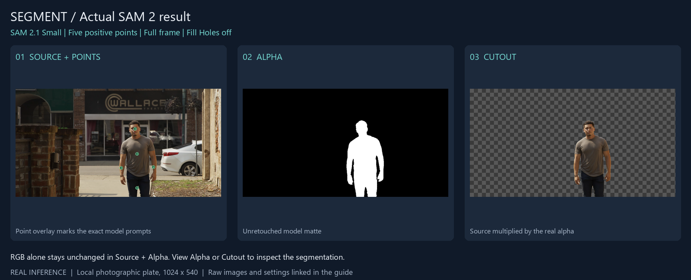
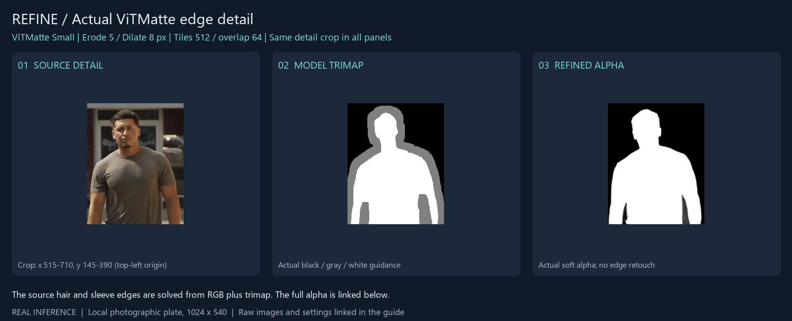
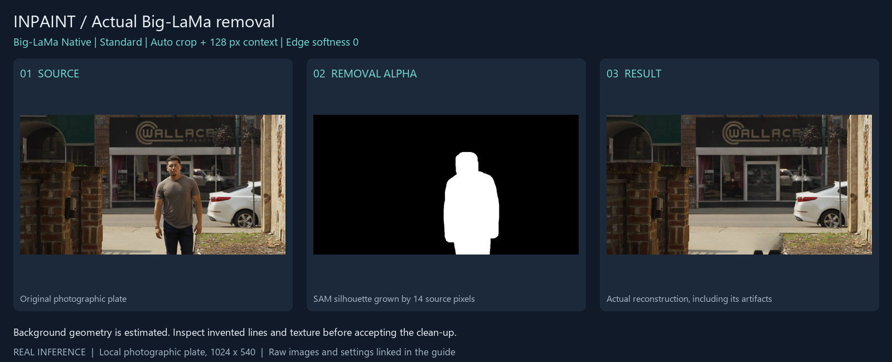
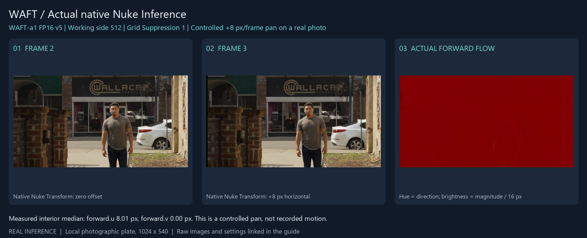

<h1><a href="https://github.com/vaaleerkiin/Kyven"></a>&nbsp;Kyven Tools</h1>

**Local AI tools for Foundry Nuke: roto, alpha refinement, inpaint, generative editing, WAFT SmartVector optical flow, and optional RTX neural reconstruction.**

[Real examples](#real-examples) · [Installation](#start-here) · [Documentation](docs/README.md)

Kyven's Segment, Refine, Inpaint, Generative Fill and DLSS nodes keep model loading and long inference outside Nuke. These nodes communicate
with a local authenticated server and return ordinary image sequences, so rendered work remains
readable even when Kyven or its models are not running.

The bundled **WAFT SmartVector** plugin calculates optical flow through native
Nuke Inference nodes, with embedded models and no Kyven server. See [WAFT](docs/WAFT.md).

> **Status:** active pre-alpha, currently developed for Nuke on Windows.
>
> **Privacy and licensing:** inference stays on the workstation. Kyven code is Apache-2.0; shipped
> model entries are pinned and checksum-verified. Production defaults have commercially
> permissive licenses; experimental MOSS Edit weights have unconfirmed commercial terms. The optional
> Generative Fill worker is separately GPL-3.0-licensed. Review
> [third-party notices](THIRD_PARTY_NOTICES.md) before production distribution.

## Start here

| Tool | What comes with the repository | First-use setup |
| --- | --- | --- |
| WAFT SmartVector | Complete Cattery folder and two Git LFS models | Clone with Git LFS, connect the Nuke plugin path; no server or Model Manager |
| DLSS | Kyven worker, shim and runtime metadata | Install **Kyven DLSS Runtime** in Model Manager; a plain Git clone downloads the NVIDIA component during that setup |
| Segment, Refine, Inpaint | Node code and selectable model catalogs | Install the desired model variants through the installer or Model Manager |
| Generative Fill | Mage-Flow Edit Turbo with Color Match, FLUX.2 Klein and Base | Mage is the default; Install / Repair Model prepares its complete setup; see [Mage](docs/MAGE_FILL.md) |

Full preview ZIP/wheel bundles can include the NVIDIA DLSS component locally.
They still use the managed runtime setup. WAFT remains an independent native
Nuke plugin with its models beside the gizmo.

**Download ZIP:** choose **Code > Download ZIP** and extract the archive. This
repository includes Git LFS models in GitHub archives, so both WAFT models arrive
inside the folder; Git and Git LFS are not required for ZIP installation.

**Clone with Git:** install Git LFS first, then run:

```bash
git lfs install
git clone https://github.com/vaaleerkiin/Kyven.git
```

For an existing clone, run `git lfs install` and `git lfs pull` from its root.
WAFT alone only needs the Nuke plugin path below; the server installer and model
selection are for the other Kyven tools.

1. Clone with Git LFS installed, or extract a complete Kyven bundle into its final
   writable folder. For an existing checkout, run `git lfs install` and `git lfs pull`
   to obtain the embedded WAFT models.
2. Add the plugin path to the user's `.nuke/init.py`:

```python
import nuke

nuke.pluginAddPath("D:/Kyven/hosts/nuke")
```

3. Restart Nuke and open **Nodes > Kyven > Model Manager**.
4. Select a model and **Install Selected**. The manager installs the base runtime,
   required components and model weights automatically. If no compatible Python
   is available, it downloads a private Python 3.12 into the Kyven folder.
   **Install Required Components** installs just the dependencies without downloading weights.
5. Create a node, choose **Cache Folder**, enter its **Name** and **Version**, then process.

`install.cmd` remains available for installation outside Nuke; choice **14** sets
up Mage Generative Fill without PyTorch or SAM. Choice **12** installs FLUX.
Both routes use the same trusted model catalog.

The installer is portable: it does not require administrator access, modify the registry, or install
system-wide Python packages. Read the [installation guide](docs/INSTALLATION.md) for requirements,
updates, moving the repository, and unattended model selection.

## Nodes

**[Visual guide to all six nodes](docs/NODES.md)** shows what to connect, which
controls to start with and what each output means. The
[Nuke control reference](docs/NODE_CONTROLS.md) records controls from actual nodes.

**WAFT SmartVector** is also bundled locally as a standalone Nuke 16 Cattery
plugin, with its FP16 and FP32 models inside `plugins/Cattery/WAFT/`. Open
**Nodes > Kyven > WAFT SmartVector**; no Kyven server or model-manager download
is required. Both deployed models are versioned through Git LFS. The complete
folder can be copied into `.nuke/Cattery/`.
See [standalone plugins](plugins/README.md) for packaging and portability.

| Node | Inputs | Use it for | Recommended starting model |
| --- | --- | --- | --- |
| **Kyven Segment** | Source + Viewer points | Single-frame roto and SAM 2 video tracking | SAM 2.1 Small |
| **Kyven Refine** | Source + coarse mask/trimap | Soft alpha and difficult boundaries | ViTMatte Small |
| **Kyven Inpaint** | Source + removal mask | Paint-out and background reconstruction | LaMa ONNX Fast |
| **Kyven Generative Fill (optional)** | Source + alpha mask + prompt | Add, replace, modify or remove content locally | Mage-Flow Edit Turbo Q6; FLUX alternatives available |
| **Kyven DLSS (optional RTX)** | Source + optional motion, depth and control mask | Neural reconstruction with temporal history | Kyven worker + separately licensed NVIDIA NR component |
| **WAFT SmartVector (standalone)** | Source image sequence | Motion Vectors or Smart Vectors | Embedded WAFT-a1 FP16 / FP32 |

External motion is required when DLSS temporal processing is enabled. The [DLSS guide](docs/DLSS.md) covers setup, external vectors, alpha as an inference guide, live
refresh and runtime limitations. Optional DLSS has no CPU inference provider.

A common roto flow is:

```text
Source ----------------------> Refine Source
Source -> Segment -----------> Refine Mask -> refined alpha for compositing
```

For temporal roto, set a key frame, add corrections where required, optionally enable
**Seamless Key Frame**, and run Forward, Backward, or Both Directions. For paint-out, connect the
original Source and a removal mask directly to Kyven Inpaint.

## Real examples

The comparisons below use a photographic plate and actual Kyven model outputs.
Results have not been retouched. Labels identify the model and settings; the
[capture notes](docs/EXAMPLES.md) link the original images, masks and recorded
requests. Segment, Refine, Inpaint, Generative Fill and DLSS were rendered through
their Kyven providers; WAFT was rendered through the deployed native Nuke gizmo.

### Segment — select an object

Connect **Source**, place positive points on the subject and click **Process
Current Frame**. **Alpha** shows the selection; **Cutout** multiplies Source by
the mask. For a shot, set a key and use SAM 2 tracking with correction frames.
This example uses SAM 2.1 Small with five positive points on the person.



[Segment guide](docs/SEGMENT.md)

### Refine — solve soft edges

Connect original **Source** and a coarse **Mask** in alpha. Inspect **Trimap**,
then **Process Current Frame** to recover soft coverage. This detail crop shows
the real Source, prepared trimap and ViTMatte Small alpha, using erosion 5 px,
dilation 8 px and 512 px tiles. The result is a matte, not replacement RGB.



[Refine guide](docs/REFINE.md)

### Inpaint — remove unwanted content

Connect **Source** and a removal **Mask**; white selects replacement pixels.
Check **Preview Model Mask**, then **Process Current Frame**. Big-LaMa Native
reconstructs the masked background without a text prompt. The example uses the
Segment silhouette grown by 14 px. Inspect the actual reconstructed geometry and
texture before accepting the result; each range frame is processed independently.



[Inpaint guide](docs/INPAINT.md)

### Generative Fill — describe the edit

Connect **Source**, an alpha **Mask**, and enter an instruction. Use **Install /
Repair Model** on first use, then **Generate Current Frame**. New nodes default
to Mage-Flow Edit Turbo Q6. Here Mage removes the person at 512 px working
resolution, four steps and seed 42. Source pixels outside the permission mask
were verified unchanged. FLUX alternatives remain selectable.


[Generative Fill guide](docs/GENERATIVE_FILL.md) · [Mage setup](docs/MAGE_FILL.md)

### DLSS — reconstruct RGB on RTX

Install **Kyven DLSS Runtime**, connect **Source** and click **Process Current
Frame**. Compare **Result** with Source using Intensity and Preserve Source Color.
This is an actual still-frame RTX render with Temporal off; the third panel
amplifies the absolute display-RGB difference by 8. The output stays at Source
resolution. Temporal processing additionally requires valid external Motion.


[DLSS guide](docs/DLSS.md)

### WAFT SmartVector — generate motion data

Connect a sequence, choose **Motion Vectors** or **Smart Vectors**, then render
with an ordinary **Write: EXR, channels = all**. No Kyven Server is needed.
For this native WAFT test, Nuke pans the real photograph by 8 px per frame.
The measured median forward motion is **8.01 px horizontally** and approximately
zero vertically. The last panel visualizes actual output channels with direction
as hue and magnitude as brightness. This controlled pan does not demonstrate
independently moving objects or occlusion handling.



[WAFT guide](docs/WAFT.md)

## Cache contract

The five server-backed nodes use the same artist-facing Folder / Name / Version layout. Segment, Refine, Inpaint and Generative Fill write PNG results; optional DLSS writes float EXR results. Standalone WAFT uses ordinary Nuke Write rendering:

```text
<Cache Folder>/
└── <Name>/
    └── <Version>/
        ├── <Name>_<Version>.1001.png  (DLSS: .exr)
        ├── <Name>_<Version>.1002.png  (DLSS: .exr)
        └── _kyven_work/
```

The version root contains the public sequence. Sources, manifests, logits, trimaps, masks, and other
implementation files stay under `_kyven_work/`. Current Frame and Frame Range write the same named sequence; Segment tracking does too. Changing Cache Folder, Name, or Version reconnects a matching sequence.
DLSS uses the same Folder / Name / Version layout with float EXR output instead of PNG; see
the [DLSS cache guide](docs/DLSS.md#resolution-memory-and-cache).

## How it works

```text
Nuke Group node
      |
      | authenticated HTTP on 127.0.0.1
      v
Kyven Server -> single GPU job queue -> selected provider/model
      |
      v
Atomic artist cache -> ordinary Nuke Read
```

- Kyven's server adapters never import PyTorch or model packages. Standalone WAFT uses Nuke's built-in Inference runtime.
- The active provider remains resident between frames and jobs.
- Long operations are asynchronous, cancellable, and report progress.
- Cache manifests reject incomplete or mismatched results.
- Identical active requests share one server job instead of duplicating inference.

## Working with cached frames

In the Nuke nodes, choose **Input Frames** and click **Cache Frames** to prepare source inputs. Current-frame processing prepares missing inputs automatically; range processing prepares any missing frames before inference. After changing an upstream image, mask, or motion vector, use **Refresh Frames** for the affected scope and process again. Cached input snapshots and results are stored under the selected cache folder, name, and version. Hover over node controls for English explanations and adjustment guidance. See the [Nuke workflow](docs/NUKE.md) for details and existing-node upgrades.

## Documentation

Open the **[documentation home](docs/README.md)**. It provides reading paths for artists,
installation, troubleshooting, pipeline integration, and development.

Most-used guides:

- [Visual guide: inputs, settings and results for every node](docs/NODES.md)
- [Nuke control reference](docs/NODE_CONTROLS.md)
- [Nuke workflow](docs/NUKE.md)
- [Segment](docs/SEGMENT.md)
- [Refine](docs/REFINE.md)
- [Inpaint](docs/INPAINT.md)
- [Generative Fill](docs/GENERATIVE_FILL.md)
- [DLSS (optional RTX)](docs/DLSS.md)
- [WAFT SmartVector](docs/WAFT.md)
- [WAFT development recovery](development/waft/README.md)
- [Models and hardware](docs/MODELS.md)
- [Troubleshooting](docs/TROUBLESHOOTING.md)

## Repository map

```text
Kyven/
├── src/kyven/       host-neutral engine, providers, server, and CLI
├── hosts/nuke/      Nuke adapter and Group-node builders
├── plugins/Cattery/WAFT/  portable WAFT plugin with local embedded models
├── development/waft/     lightweight WAFT sources and recovery instructions
├── docs/            user and technical documentation
├── tests/           engine, server, and adapter tests
├── models/          locally installed weights; not committed
└── .runtime/        local server state and logs; not committed
```

Kyven is pre-alpha. Treat cached renders as working assets, while node layouts and provider APIs may
still change between revisions.
