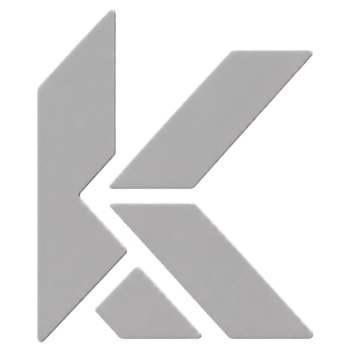

<h1><a href="https://github.com/vaaleerkiin/Kyven"></a>&nbsp;Kyven Tools</h1>

**Local AI tools for Foundry Nuke: roto, alpha refinement, and inpaint.**

Kyven keeps PyTorch, CUDA, model loading, and long inference outside Nuke. The nodes communicate
with a local authenticated server and return ordinary image sequences, so rendered work remains
readable even when Kyven or its models are not running.

> **Status:** active pre-alpha, currently developed for Nuke on Windows.
>
> **Privacy and licensing:** inference stays on the workstation. Kyven code is Apache-2.0; shipped
> model entries are pinned, checksum-verified, and commercially permissive. Review
> [third-party notices](THIRD_PARTY_NOTICES.md) before production distribution.

## Start here

1. Clone or extract Kyven into its final writable folder.
2. Run `install.cmd` and choose the recommended models.
3. Add the printed plugin path to the user's `.nuke/init.py`:

```python
import nuke

nuke.pluginAddPath("D:/Kyven/hosts/nuke")
```

4. Restart Nuke and open `Nodes > Kyven`.
5. Create a node, choose **Cache Folder**, enter its **Name** and **Version**, then process.

The installer is portable: it does not require administrator access, modify the registry, or install
system-wide Python packages. Read the [installation guide](docs/INSTALLATION.md) for requirements,
updates, moving the repository, and unattended model selection.

## Nodes

| Node | Inputs | Use it for | Recommended starting model |
| --- | --- | --- | --- |
| **Kyven Segment** | Source + Viewer points | Single-frame roto and SAM 2 video tracking | SAM 2.1 Small |
| **Kyven Refine** | Source + coarse mask/trimap | Soft alpha and difficult boundaries | ViTMatte Small |
| **Kyven Inpaint** | Source + removal mask | Paint-out and background reconstruction | LaMa ONNX Fast |

A common roto flow is:

```text
Source -> Kyven Segment -> optional Kyven Refine -> compositing nodes
```

For temporal roto, set a key frame, add corrections where required, optionally enable
**Seamless Key Frame**, and run Forward, Backward, or Both Directions. For paint-out, connect the
original Source and a removal mask directly to Kyven Inpaint.

## Cache contract

New Segment, Refine, and Inpaint nodes use the same artist-facing layout:

```text
<Cache Folder>/
└── <Name>/
    └── <Version>/
        ├── <Name>_<Version>.1001.png
        ├── <Name>_<Version>.1002.png
        └── _kyven_work/
```

The version root contains the public sequence. Sources, manifests, logits, trimaps, masks, and other
implementation files stay under `_kyven_work/`. Current Frame, Frame Range, and tracking write the
same named sequence. Changing Cache Folder, Name, or Version reconnects a matching sequence.

## How it works

```text
Nuke Group node
      |
      | authenticated HTTP on 127.0.0.1
      v
Kyven Server -> single GPU job queue -> selected provider/model
      |
      v
Atomic artist cache -> ordinary Nuke Read
```

- Nuke never imports PyTorch or model packages.
- The active provider remains resident between frames and jobs.
- Long operations are asynchronous, cancellable, and report progress.
- Cache manifests reject incomplete or mismatched results.
- Identical active requests share one server job instead of duplicating inference.

## Documentation

Open the **[documentation home](docs/README.md)**. It provides reading paths for artists,
installation, troubleshooting, pipeline integration, and development.

Most-used guides:

- [Nuke workflow](docs/NUKE.md)
- [Segment and video tracking](docs/SEGMENT.md)
- [Refine](docs/REFINE.md)
- [Inpaint](docs/INPAINT.md)
- [Models and hardware](docs/MODELS.md)
- [Troubleshooting](docs/TROUBLESHOOTING.md)

## Repository map

```text
Kyven/
├── src/kyven/       host-neutral engine, providers, server, and CLI
├── hosts/nuke/      Nuke adapter and Group-node builders
├── docs/            user and technical documentation
├── tests/           engine, server, and adapter tests
├── models/          locally installed weights; not committed
└── .runtime/        local server state and logs; not committed
```

Kyven is pre-alpha. Treat cached renders as working assets, while node layouts and provider APIs may
still change between revisions.
