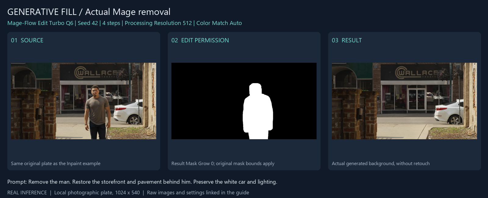

# Generative Fill

[Documentation home](README.md) · [Visual guide](NODES.md#generative-fill) ·
[Nuke workflow](NUKE.md) · [Mage details](MAGE_FILL.md) · [Troubleshooting](TROUBLESHOOTING.md)

**Kyven Generative Fill edits a masked region using a text instruction.** Remove,
add, replace or modify content with **Nodes > Kyven > Generative Fill**. The native
Nuke Group sends Source and Mask to a separate local worker. No ComfyUI or hosted
inference service is required.



*Actual Mage-Flow Edit Turbo Q6 generation. [Raw images and settings](EXAMPLES.md#generative-fill).*

## Choose a backend

| Model | New-node settings | Processing Resolution limit | Runtime / edges |
| --- | --- | --- | --- |
| **Mage-Flow Edit Turbo Q6** | Factory default; 512 px, 4 steps | 2048 px | Private stable-diffusion.cpp worker; alpha feathering and Color Match |
| **FLUX.2 Klein 4B Q4 + LanPaint** | Alternative; 512 px, 4 steps | 1024 px | Private Torch/Diffusers/LanPaint worker; optional Seamless Blend |
| **FLUX.2 Klein 4B Base Q4 + LanPaint (Preview)** | Preview; 20 steps, Base Guidance 4 | 1024 px | Undistilled and slower; validate every shot |

**Set as Default** in Model Manager affects new nodes. Existing nodes retain their
selection. Mage hides LanPaint, VAE tile and Base-only controls. MOSS is retired
from normal selection; its catalog entry remains for managing existing installs.
[MOSS notes](MOSS_FILL.md) cover that experimental backend.

## First use

1. Create **Generative Fill**, select the model, then **Install / Repair Model**.
   Model Manager installs/verifies weights, required components and the private
   runtime. A private Python 3.12 is prepared if needed. **Install Required
   Components** installs dependencies only, without weights.
2. Connect Source to **input 1, Source** (left), edit Mask to **input 0, Mask**
   (right). Mask reads **alpha**, not RGB: white selects edits, black protects
   Source, fractional alpha controls the final blend.
3. Enter Prompt, for example `Remove the vase and continue the wall and floor`.
   English and Russian work; non-Latin image prompts are translated locally.
   **Improve Prompt** and **Restore Original** are optional text actions.
4. Set **Cache Folder**, **Fill Name** and **Version**. Start with **Processing
   Resolution 512**, then **Generate Current Frame**.
5. Inspect **Result**, **Difference** and the mask edge. Change seed, instruction,
   mask or context and generate again. Test before **Generate Frame Range**.

Mage's verified download is about 7.69 GB, plus extracted runtime/Python files;
allow roughly 12 GB for the bundle/executables, plus packages. Installing Mage
alone does not install PyTorch, SAM or FLUX. The distilled FLUX bundle is about
10.83 GB and uses a separate environment. Artifacts are revision-pinned and
size/SHA-256 verified. See [Mage setup](MAGE_FILL.md).

Optional CLI setup: `install.cmd -Model mage-flow-edit-turbo-q6` for Mage, or
`.venv/Scripts/python.exe scripts/setup_generative_fill.py --download-models`
for distilled FLUX.

## Crop and processing resolution

**Crop Mode = auto** finds the effective mask bounds, adds **Context Padding**
(256 source pixels by default) and clips to Source. **manual** uses the Viewer
ROI; **full** uses the whole frame. **Processing Resolution** limits the maximum
crop side with aspect-preserving resize and model padding. The patch returns to
source crop resolution and full Source format. Output size is not working size.

Start at 512. More context can help continuation, but a larger crop at the same
working side reduces detail per source pixel. Mage supports up to 2048; above
1024 its editing reference is reduced for Qwen3-VL context while the diffusion
canvas retains the selected resolution. FLUX is limited to 1024.
CLI/API `FillSettings.working_size` defaults to 768; new Nuke nodes start at 512.

## Artist permission, sampling mask and edges

Two masks serve different purposes:

- **Result permission:** input alpha after inversion/threshold. With **Result Mask
  Grow 0**, final RGB edits stay within this alpha. Retained soft coverage controls
  compositing, with optional inward **Result Edge Softness** (default 4 px).
- **Sampling region:** binary model mask plus **Model Mask Grow** and **Generation
  Overlap** (default 32 source pixels). This additional context moves model
  transitions away from the composite edge without authorizing extra edits.

**Preview Model Mask** shows the combined sampling region, which can exceed final
permission. An empty mask returns Source without loading an image model.
**Result** preserves Source alpha and auxiliary channels; RGB-only Source receives
opaque alpha. Protected RGB comes from live float Nuke Source, bypassing generation.

Mage's **Result Mask Grow (px)** explicitly permits RGB edits in an extra dilated
band around nonzero artist alpha. **Smooth Removal Edges** prepares Auto crop,
padding 384, processing resolution 1024, grow 32, softness 24, overlap 0 and Auto
Color Match. Generate again to apply it. This preset widens permission, so the
exact original alpha boundary no longer limits RGB edits. Outside the expanded
band Source stays protected. See [tight masks](MAGE_FILL.md#tight-masks-and-visible-outlines).

## Color and boundary matching

**Color Matching = Auto**, **Color Match Strength = 1**, **Color Match Radius = 64**
are defaults. Auto calibrates clean Source context and matches continuous local
backgrounds for explicit removals. **Context** preserves new subject colors;
**Background** forces removal-style matching. **Off** or strength 0 disables
correction; radius 0 disables the local transition. Insufficient context can cause
matching to be skipped. It cannot fix wrong geometry or an unmasked shadow.

Mage uses standard inward alpha feathering and Color Match. Current node requests
disable experimental boundary repair and Seamless Blend; legacy knobs are hidden.
No second neural boundary pass runs from the node.

FLUX exposes **Seamless Blend**. Auto uses a CPU gradient-domain solve for removals
and Base edits; distilled additions/replacements keep context color calibration.
**On** forces the solve for other edits too and can shift new subject colors.
**Off** uses standard masked compositing. A successful solve bypasses inward
feathering to avoid mixing the old object back into the boundary. Structural
generation errors can still remain visible.

## Outputs and cache

Output switching does not rerun generation.

| Output | Result |
| --- | --- |
| **Result** | Edited RGB with Source alpha and auxiliary channels; default |
| **Result + Mask Alpha** | Edited RGB with result permission alpha |
| **Result Premult** | Result + Mask Alpha with RGB premultiplied |
| **Generated Patch** | Full-format replacement RGB with permission alpha for external compositing |
| **Difference** | Absolute RGB change compared with Source |
| **Source** | Source bypass |

Generation uses sRGB and caches generated RGB as 8-bit sRGB PNG. Set **Input
Colorspace** to the actual incoming space. HDR reconstruction inside the edit
is not supported; protected live Source retains its original Nuke precision.
Use a normal Nuke Write on the Group to save its final color-managed output and
preserved channels rather than treating a cached PNG as a complete float/AOV render.

Public results are `<Cache Folder>/<Fill Name>/<Version>/<Fill Name>_<Version>.%04d.png`.
Private inputs, masks, patches and manifests remain under `_kyven_work/`.
**Create Result Read** opens the cache. **Refresh Frames** after upstream edits,
then Generate again. Cache identity includes inputs, prompt, seed, crop, solver
settings and pinned model. Range frames are generated independently; there is no
temporal consistency. Live generation is hidden and off.

## Prompt improvement and advanced controls

The selected backend's local Qwen helper improves text and translates prompts.
**Improve Prompt** changes text, not image pixels; generate afterward.
**Restore Original** restores text kept before the last successful improvement.
Late replies do not overwrite a newer artist edit. The helper is text-only and
cannot inspect Source.

Advanced contains System Prompt, token limit, temperature, top-p, prompt timeout,
reset and last improved text. These affect prompt improvement. Diffusion Steps,
generation timeout, OOM retry and memory profile affect image generation. FLUX
also exposes LanPaint solver settings and VAE Tile Size; Base exposes Base Guidance.
Distilled Klein guidance stays fixed at 1. See the
[control reference](NODE_CONTROLS.md#generative-fill--mage).

## Memory and recovery

This optional heavier workflow leaves the CPU/4 GB LaMa path available. Recorded
GPU qualification used RTX 4070 Laptop 8 GB / 32 GB RAM. CPU inference is selectable,
but a lightweight CPU smoke test is not a full-size quality/performance benchmark.

Qwen text encoding runs on CPU; image stages use staged GPU execution. On CUDA OOM
the default retries once at a smaller working size and reports that actual size.
A second failure returns a recoverable error. Cancel, timeout or unload terminates
the private worker; successful workers stay resident. Logs are under
`.runtime/mage-fill/` or `.runtime/generative-fill/` for the selected backend.

## Measured qualification

[Mage qualification](MAGE_FILL.md#qualification) records installation, Nuke
save/reopen and measured generation. Six tasks on one street frame with two seeds
each, at a maximum 512-pixel crop side, gave median image-generation times of
12.35 s for Mage and 30.96 s for distilled FLUX. These compare complete backends,
not equalized kernels; device memory measurements include other applications.

Earlier FLUX runs (2026-11-24, RTX 4070 Laptop 8 GB / 32 GB RAM) on a 2048 × 1080
street image verified removal, addition and replacement at four diffusion/two
thinking steps. Working canvases were 688 × 768 or 736 × 544. GPU generation with
precomputed English embeddings took 30.2–37.2 s and 3.17–3.29 GiB peak Torch
allocation; full cold requests took longer. Source bytes outside each mask were
unchanged. A separate Base 20-step/CFG-4 removal took 175.56 s at 2.91 GiB peak,
but changed background text and geometry. These are recorded examples, not a
quality guarantee or a fresh comparison at today's 512-pixel Nuke default.

Native Nuke graph checks also covered cached patches, HDR/negative Source values,
alpha, masks, alignment and reopen without invoking full image inference.

## CLI and API

`kyven generative-fill --request request.json --models-dir models` accepts absolute
paths, crop/mask settings, a model ID and a `fill` settings object:

```json
{
  "source": "D:/shot/source.png",
  "mask": "D:/shot/mask.png",
  "output": "D:/shot/fill.png",
  "model_id": "mage-flow-edit-turbo-q6",
  "context_padding": 256,
  "mask_grow": 0,
  "edge_softness": 4,
  "fill": {"prompt": "Add a blue ceramic vase", "seed": 42, "working_size": 512}
}
```

Request/API model fallback remains distilled FLUX if no model is specified; it
does not read Nuke's saved model default. HTTP routes are
`POST /v1/jobs/generative-fill` and `POST /v1/jobs/prompt-enhance`, with standard
job polling/cancellation. `kyven prompt-enhance --prompt "a blue vase" --models-dir models`
improves text; `--system-prompt instructions.txt` supplies a custom instruction.

## Licensing and updates

Mage/Q6 conversion, stable-diffusion.cpp and llama.cpp are MIT; Qwen3-VL is
Apache-2.0. CUDA redistributables retain NVIDIA's terms. Mage does not import
LanPaint or the GPL FLUX worker.

FLUX Klein/Qwen/VAE weights are Apache-2.0. LanPaint, its pipeline and the separate
FLUX worker are GPL-3.0; preserve notices and corresponding source when distributing.
The Nuke adapter and IPC client remain Apache-2.0. See
[notices](../THIRD_PARTY_NOTICES.md) and [ADR 0009](adr/0009-generative-fill.md).

Restart Nuke and the server after updating. Generative Fill has no separate
Upgrade Selected menu command. Saved fill groups use graph/control repair on
refresh; **Upgrade Selected Inpaint Node** also recognizes a Generative Fill
Group and refreshes its graph. Existing FLUX/Base selections and rendered caches
remain. Early Z-Image IDs
migrate to distilled Klein, invalidating old inference identity without deleting
renders. Follow WAFT's separate update procedure for that standalone plugin.
