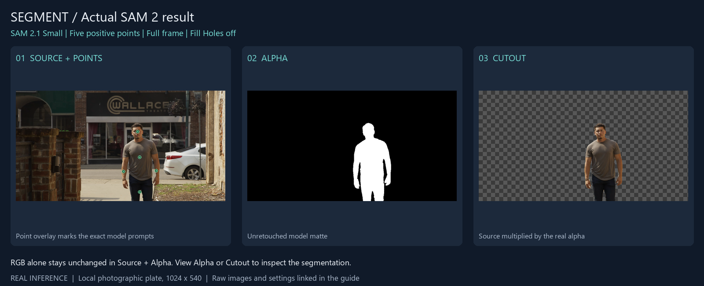
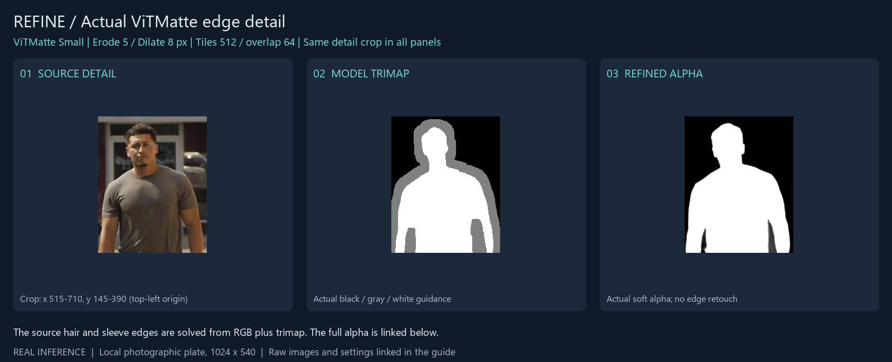
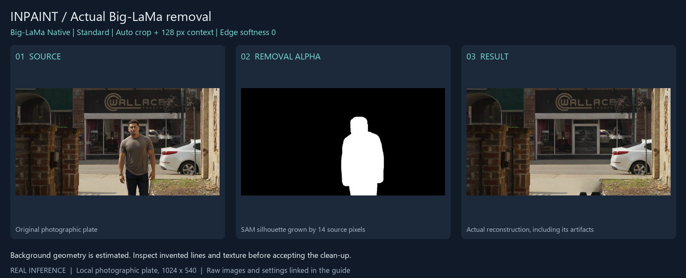
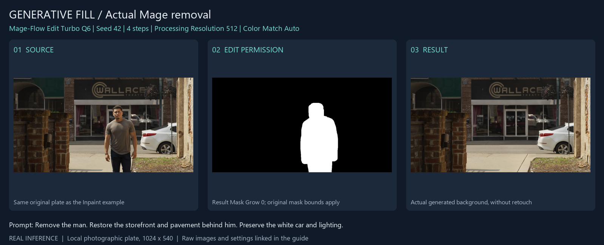
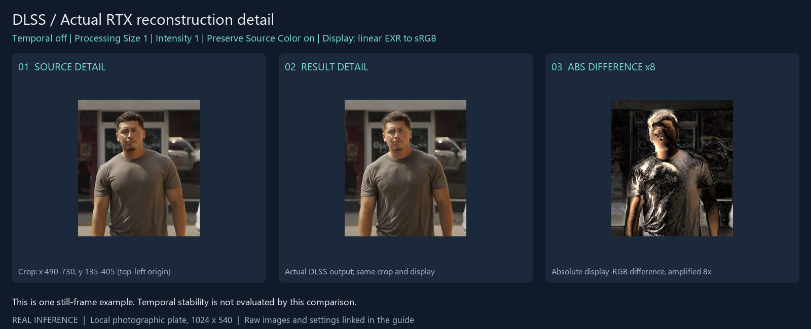
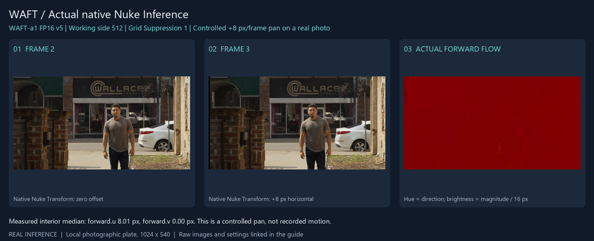

# Visual guide to all six nodes

[Documentation home](README.md) · [Install](INSTALLATION.md) ·
[Shared Nuke workflow](NUKE.md) · [Control reference](NODE_CONTROLS.md)

Choose a node by the result you need. The comparisons below use a real
photographic plate and actual model results. Read the [capture notes](EXAMPLES.md)
for raw images, settings, display transforms and scope. Quality depends on the shot.

| I need… | Node | What comes out | Sequence behavior |
| --- | --- | --- | --- |
| A mask of an object | [Segment](#segment) | Binary alpha or three-state Edge Guide | SAM 2 tracking or independent frames |
| A better soft edge on an existing mask | [Refine](#refine) | Soft refined alpha | Independent frames |
| To remove an object without a prompt | [Inpaint](#inpaint) | Reconstructed RGB | Independent frames |
| To add, replace, change or remove content using text | [Generative Fill](#generative-fill) | Generated RGB within the result permission mask | Independent frames |
| Optional neural RGB reconstruction on RTX | [DLSS](#dlss) | Reconstructed RGB, original alpha/AOVs | Optional temporal history with external motion |
| Motion data between adjacent frames | [WAFT SmartVector](#waft-smartvector) | Vector channels | Adjacent-frame optical flow |

## Segment

**Connect:** original Source to the single input. Put a positive Viewer point
inside the subject; enable negative points to reject unwanted regions.

**First frame:** install SAM 2.1 Small (Tiny for the 4 GB profile), choose Cache
Folder / Roto Name / Version, then **Process Current Frame**. Select **Alpha** to
judge the silhouette. **Source + Alpha** keeps Source RGB, so unchanged-looking
RGB in the Viewer does not mean segmentation failed.

**Result:** white alpha selects the object, black rejects background. **Cutout**
multiplies RGB by alpha. **Edge Guide** is confidence guidance for Refine, not a
solved soft matte.

**For a shot:** set a key, add correction frames, then run Forward / Backward /
Both Directions. **Process Frame Range** segments frames independently. One
Segment node tracks one object.

[Full guide](SEGMENT.md) · [Controls](NODE_CONTROLS.md#segment)

## Refine

**Connect:** original Source to **input 1, Source** (left), coarse alpha or trimap
to **input 0, Mask** (right). Source RGB supplies the edge detail.

**First frame:** keep **Generate Trimap from Mask** on for a coarse mask. Inspect
**Trimap** and adjust **Foreground Erosion** / **Background Dilation**. Gray marks
the unknown region. Process, then inspect **Refined Matte** or **Source + Refined
Alpha**. Start with ViTMatte Small; reduce Tile Size if memory is insufficient.

**Result:** soft alpha for partial coverage. The mask must already identify the
subject. When Segment supplies **Edge Guide**, turn **Generate Trimap from Mask**
off. **Show Tiles** previews a processing plan, not a model result.

**For a shot:** each frame is independent. Optional Manual ROI alpha integration
affects the Group output; save it with a normal Write. **Create Matte Read** opens
the cached model matte before that integration.

[Full guide, tiles and integration](REFINE.md) · [Controls](NODE_CONTROLS.md#refine)

## Inpaint

**Connect:** Source to **input 1, Source** and removal alpha to **input 0, Mask**.
White marks pixels to replace. Copy an RGB-only mask into alpha upstream.

**First frame:** choose a model, Cache Folder / Inpaint Name / Version. Check
Threshold, Invert and Model Mask Grow with **Preview Model Mask**, turn preview
off, then **Process Current Frame**. Auto crop includes surrounding context.
The factory model is Big-LaMa Native; LaMa ONNX Fast is the CPU/live-preview option.

**Result:** estimated replacement background, without a text prompt. Hidden plate
detail is reconstructed, not recovered exactly. **Result** has opaque alpha;
**Result + Mask Alpha** and **Generated Patch** support compositing.
**Difference** reveals changed RGB. Mask preprocessing affects both the model
region and composite; see the guide before disabling it.

**For a shot:** texture can flicker or swim because frames are independent.
Big-LaMa **Refined** is slower feature optimization, not temporal stabilization.

[Full guide and masks](INPAINT.md) · [Controls](NODE_CONTROLS.md#inpaint)

## Generative Fill

**Connect:** Source to **input 1, Source**, edit alpha to **input 0, Mask**. Enter
an instruction such as “Add a blue ceramic vase” or “Remove the vase and continue
the wall and floor.” Russian prompts are translated locally.

**First frame:** Mage-Flow Edit Turbo Q6 is the factory default. **Install / Repair
Model** prepares the selected backend. Start at **Processing Resolution 512**,
set Cache Folder / Fill Name / Version, then **Generate Current Frame**.
Live generation is hidden and off.

**Result:** edited RGB with Source alpha and other channels in **Result**. With
**Result Mask Grow 0**, model growth/overlap cannot authorize changes outside
artist alpha. Positive Mage **Result Mask Grow** explicitly permits an extra band.
**Smooth Removal Edges** sets grow to 32 px; Generate again to apply the preset.

**For a shot:** a fixed seed does not provide temporal consistency. Inspect
geometry and edges. Color Match corrects color/exposure, not wrong structure.
Edited RGB uses an 8-bit sRGB cache; protected live Source retains Nuke precision.

[Full guide](GENERATIVE_FILL.md) · [Mage details](MAGE_FILL.md) ·
[Controls](NODE_CONTROLS.md#generative-fill--mage)

## DLSS

**Connect:** Source to **input 0**. **Input 1 Motion** must be current-to-previous
displacement for temporal processing; **input 2 Depth** and **input 3 Mask** are
optional guides. Install **Kyven DLSS Runtime** in Model Manager. Requires Windows
and NVIDIA RTX.

**First frame:** set Cache Folder / Name / Version, then **Process Current Frame**.
Compare **Result** with **Source**, adjusting Intensity and Preserve Source Color.
Processing Size scales the working image; output retains Source resolution.
The actual example compares a still-frame render with matching Source detail.
Its amplified difference panel shows where display RGB changed.

**Result:** float EXR RGB reconstruction; the connected Group preserves Source
alpha and auxiliary channels. A mask guides changes rather than replacing output
alpha. Configure Protect Outside Mask when using a guide.

**For a shot:** connect valid Motion, verify channels/direction/units, enable
**Enable Temporal (external vectors)** and process forward from the shot start.
**Load Cache** reopens results without the server or runtime.

[Full guide and temporal limits](DLSS.md) · [Controls](NODE_CONTROLS.md#dlss)

## WAFT SmartVector

**Connect:** a sequence to its single input; adjacent frames must be available.
WAFT uses embedded FP16/FP32 models and native Nuke Inference, without Kyven Server
or Model Manager.

**First frame:** select Input Colorspace, **Processing Resolution 512 (Low VRAM)**,
**Precision GPU FP16 (Fast)** and Output Mode. Render with a normal Write,
**EXR, channels = all**. GPU off selects the FP32 CPU path.

**Result:** Motion Vectors (`forward.u/v`, `backward.u/v`) or Smart Vectors
(`smartvector_f01_v01.n_u/n_v/p_u/p_v`). Output is channel data, not visible arrows
or RGB. Copy vector layers into Source if you need RGB and vectors together.

**For a shot:** render normally. Read range settings govern missing neighbors
at sequence boundaries. Before using WAFT with DLSS, verify backward mapping,
direction and units on a moving test frame.

[Full guide and channels](WAFT.md) · [Controls](NODE_CONTROLS.md#waft-smartvector)

## Check the first result

1. View the right channels: alpha for masks, RGB for fills, vector layers for WAFT.
2. Check Source/mask frame, format and alignment, and that the crop covers the edit.
3. After upstream edits on server-backed nodes, **Refresh Frames** for that scope,
   then Process or Generate again.
4. Test one frame before a range. Folder / Name / Version identifies the shared
   cache; choose another name/version to keep a comparison.

The [control reference](NODE_CONTROLS.md) records actual Nuke controls. Rebuild
figures using the [documented capture workflow](EXAMPLES.md#reproduce-the-capture). Use
[benchmarks](BENCHMARKS.md), [Mage qualification](MAGE_FILL.md#qualification) and
[testing notes](TESTING.md) for measured evidence.
