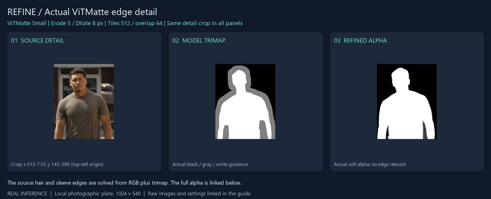

# Kyven Refine

[Documentation home](README.md) · [Nuke workflow](NUKE.md) · [Segment](SEGMENT.md) ·
[Models](MODELS.md) · [Troubleshooting](TROUBLESHOOTING.md)

Kyven Refine supports ViTMatte and the memory-efficient MEMatte ViT-S AIM-500 backend. Both consume
the same source RGB and binary mask/trimap inputs and produce the same alpha/output branches.

Refine converts a coarse mask into a soft alpha matte while keeping model inference outside the compositing host.



*Actual ViTMatte Small detail crop. [Raw images and settings](EXAMPLES.md#refine) ·
[Input/settings/result walkthrough](NODES.md#refine) ·
[Captured Nuke controls](NODE_CONTROLS.md#refine).*

## On this page

- [Quick start](#quick-start)
- [Nuke graph](#nuke-graph)
- [Trimap option](#trimap-option)
- [Processing and performance](#processing)
- [Tiling and tile preview](#tiling-and-tile-preview)
- [Optional alpha integration](#optional-alpha-integration)
- [Cache](#cache)
- [CLI](#cli)
- [Updating an existing node](#updating-an-existing-node)

Kyven offers the official ViTMatte Small and Base backbone sizes. There is no official Medium
variant. Small Composition-1k is the recommended 4–8 GB default; Base Distinctions-646 has 96.7 M
parameters and is intended for 8 GB+ systems with tiling when required. Install either checkpoint
from **Kyven > Model Manager...** without rerunning the portable installer.

## Quick start

1. Connect Source and a coarse Mask with the matte in alpha, as shown below.
2. Choose an installed model and set Cache Folder, Refine Name and Version.
3. Inspect **Trimap** output and adjust Foreground Erosion and Background Dilation; disable trimap generation if your input is already a trimap.
4. Press **Process Current Frame** and inspect **Source + Refined Alpha**. Set the frame range and process it when the result is ready.

Hover over controls for English help. See [shared processing and cache](NUKE.md#input-preparation-and-processing) for refreshing inputs after upstream edits.

## Nuke graph

```text
Source --------------------> Kyven Refine (input 1, left)
Source -> Kyven Segment ---> Kyven Refine (input 0, right)
```

Input 1 is the original RGB image. Input 0 is normally any mask with useful alpha: Segment, Keyer,
Paint, or a corrected combination of those nodes. The connector labels are the safest guide: Source
is on the left and Mask is on the right.
The Mask input always reads **alpha**. There is no Alpha/Red selector. For a grayscale RGB
image, copy its matte into alpha upstream with a Shuffle or Copy node. Existing nodes also use
alpha after upgrade; their old channel selector is hidden and disconnected.

## Trimap option

`Generate Trimap from Mask` is enabled by default and is part of Refine, not a separate node.
Generation uses the simple Cattery ViTMatte recipe: erode and dilate the original Mask alpha,
average those two masks equally, then map values below 0.01 to black, above 0.99 to white,
and everything else to gray. The mask is not binarized before morphology. Foreground Erosion and
Background Dilation control the two radii. Disable the option when the Mask input is already
an artist-created black/gray/white trimap; the same cutoffs apply without erosion/dilation.
With generation disabled, alpha is quantized to three guidance states; the gray unknown region
is deliberately preserved. In Segment this input is called **Edge Guide**.

The `Output` selector includes the exact trimap written for ViTMatte:

- `Trimap` displays the black / gray / white guidance as RGBA;
- `Source + Trimap Alpha` keeps Source RGB and places the trimap in alpha;
- `Trimap Cutout` premultiplies Source RGB by the trimap.

`Source + Refined Alpha` is the default output. When Processing ROI is enabled, areas outside the
actual model crop are black in the trimap preview because they were not sent to ViTMatte.

## Processing

- `Live Current Frame` follows the timeline and regenerates ViTMatte after model/ROI changes.
- `Process Current Frame` updates one cached matte.
- `Process Frame Range` exports and refines every selected frame sequentially.
- `Create Matte Read` creates a standard Nuke Read for the cached frame or sequence.
- `Cancel` stops queued work cooperatively.

Manual current-frame processing and frame-range processing open a native Nuke progress window with
export stage, frame/tile progress, percentage, ETA, and Cancel. Live refreshes remain unobtrusive and
report through the node Status field instead of opening a new window after every Viewer edit.

Range processing prepares reusable lossless TIFF snapshots for Source and Mask, then runs the selected provider sequentially. Use **Refresh Frames** after upstream changes; see [input preparation](NUKE.md#input-preparation-and-processing). The selected provider remains resident across the range.

Inverted ROI corners are normalized, ROI is clamped to the input, and an empty/outside ROI safely
falls back to the full input format.

The artist-facing output is `<Refine Name>_<Version>.%04d.png`. Source, mask, trimap, preview,
manifest, and other implementation files are kept under `_kyven_work/`. Range processing connects
internal Reads to both the public refined sequence and private trimap sequence. **Create Matte Read**
creates a normal Read for the public output; use the node's trimap modes to inspect guidance.

Trimap preview is independent of ViTMatte. Connecting or changing the Mask input, moving to another
frame, or adjusting `Foreground Erosion`, `Background Dilation`, trimap mode, or ROI immediately
rebuilds the black/gray/white preview on CPU. The two radius controls are full-width sliders. This
preview does not load or run ViTMatte; press Process only when the guidance looks correct.

Processing ROI crops both image and mask before inference, then pastes the refined alpha into the
full-size coarse mask. Manual ROI remains the exact model crop; tiles never extend beyond it.

## Tiling and tile preview

**Tiling Mode** has two explicit choices. The summary beneath the controls shows the chosen size,
overlap, and step before processing.

| Mode | Behavior |
| --- | --- |
| **Tiles** | Adjust **Tile Size (px)** and **Tile Overlap (px)**; size is at least 128 px |
| **Full Crop** | One pass over the entire processing crop, with no tile grid |

Auto is removed. The sliders stay visible, with size and overlap remembered and disabled in Full
Crop. Returning to Tiles restores them. Changing Memory Profile does not change tile size; MEMatte
still uses the profile for its model token budget.

Tile size is the maximum side in source-image pixels. Images are not scaled down. Tiles run one at
a time; smaller tiles reduce peak inference memory but give the model less context. Larger tiles
give more context and use more memory. Different tile sizes can change the result.
Tile Size and Tile Overlap are full-width sliders. The tile-size slider covers 128–2048 px;
larger custom values can still be typed. Context Padding also has a full-width 0–1024 px slider
in Auto crop mode. Numeric animation and existing values survive node upgrades.

**Tile Overlap (px)** is the minimum shared border. The regular step is `Tile Size - Overlap`:
1024 px with 64 px overlap advances by 960 px. The final row/column is aligned to the crop boundary,
so those tiles can overlap more. Predictions blend across their shared borders to reduce tile seams.
Overlap must be smaller than half the tile size. More overlap repeats work. Tile overlap is separate
from the optional ROI integration feather below.

**Skip Black / White Tiles** is enabled by default for both ViTMatte and MEMatte. A tile runs only
if its **trimap** contains gray unknown pixels. Definite black and white are restored to alpha 0/1
without model inference. This includes gray transparency inside a subject as well as its contour;
dark/bright RGB pixels alone are not a reason to skip anything. Every active tile retains its full
RGB and trimap context, including surrounding known areas. If the crop is fully known, no model
is loaded or run. Disable skipping for a comparison with the complete tile grid.

Full Crop still processes the whole crop when any gray pixels are present. Use Tiles
tiling to avoid passes over large known regions. After processing, Status reports actual counts,
for example `tiles 4/16 | 12 known skipped`.

Enable **Show Tiles** to inspect the exact current-frame plan over Source before inference.
Disable it to return to your previously selected matte, cutout, trimap or Source output; size and
overlap stay unchanged. The toggle is off by default. **Preview Tiles** also enables the display
and explicitly refreshes upstream inputs. Selecting **Tile Preview** directly in Output stays
synchronized with the toggle.

The preview colors are:

- **Green RUN** square outlines go to the model. **Show Tile Labels** optionally adds numbers/sizes.
- **Gray SKIP** boxes are filled from known trimap states.
- **Yellow** marks the unknown pixels that need solving; the rest of each active box is context.
- **Cyan** outlines the processing crop; the area outside it is shaded.

View RGB to see those colors. If the Viewer is still set to Alpha from matte inspection, it also
shows a grayscale tile-coverage diagnostic instead of a flat Source alpha.

The preview also reports RUN/SKIP totals, unknown-pixel count, and crop dimensions. It uses the same
crop resolver and tile planner as inference, including Auto bounds and Manual ROI. The local server
builds the overlay on CPU without loading model packages or weights. Tile/trimap/ROI control changes
and timeline moves refresh it automatically. Square outlines and the yellow unknown band follow
size/overlap and trimap sliders immediately through a native Nuke graph, while the green/gray
RUN/SKIP colors update in the background. The legend and preview block keep the same height while
loading or reporting an error. Slider events are coalesced to the latest settings; color updates
preserve Nuke's upstream RAM cache instead of forcing the comp to render again.
The same-frame mask snapshot is reused while editing tile geometry, overlap, padding, or labels;
the CPU server also reuses prepared guidance in a bounded 64 MB cache. Only a new frame, changed
connections, or explicit Preview Tiles refresh requires a new mask export. Click Preview Tiles again
after upstream edits on the same frame. While viewing Tile Preview, Live callbacks do not submit inference; explicit Process
buttons remain available. Preview files are temporary, separate from artist result caches.

If a tile runs out of memory, the job returns a structured error without publishing a partial
result. Choose Tiles and reduce Tile Size to 512 px or smaller, or use CPU. Skipping known tiles saves
work; it does not lower the peak memory of an active tile. Providers still unload normally.

## Optional alpha integration

For local repairs to an existing alpha, enable **Blend ROI into Input Alpha** in
**Alpha Integration / Optional**. This is off by default and applies in **Manual** crop mode.
The entire integration section is hidden in Auto and Full; returning to Manual restores its settings.
It combines the already cached refined matte with the live **Mask** input alpha on the node's
output. It does not change model inputs, crop size, trimap generation, or cached files.

**ROI Feather (px)** controls the smooth transition inward from the Manual ROI boundary.
Start with 64 px and increase it if the boundary is still visible. The center keeps the refined
matte; outside the ROI, the original incoming float alpha is preserved. The blend changes the
contribution of each matte without blurring hairs. A value of 0 gives a hard paste. Borders that
touch the source image edge are not faded, and the feather is limited for very narrow ROIs.

Toggling integration or adjusting its feather updates immediately, including with the server
stopped; it does not start model processing, even with Live enabled. The three refined output modes
use the integrated alpha. Trimap modes are independent. Use a normal Nuke **Write** connected to
the Group to save the integrated result; **Create Matte Read** opens the cached model result.

After updating, restart Nuke or use **Kyven > Upgrade Selected Refine Node** to add the optional
controls to an existing node. Its cached matte and current processing settings are preserved.

## Outputs

Output changes do not rerun matting. The first three modes use optional alpha
integration when enabled; trimap and preview modes remain independent.

| Output | Result |
| --- | --- |
| **Refined Matte** | Refined alpha shown as grayscale RGBA |
| **Source + Refined Alpha** | Original RGB with refined alpha; default |
| **Refined Cutout** | Source RGB multiplied by refined alpha |
| **Trimap** | Black/gray/white model guidance in RGBA |
| **Source + Trimap Alpha** | Source RGB with guidance in alpha |
| **Trimap Cutout** | Source RGB multiplied by trimap guidance |
| **Source (Bypass)** | Unchanged Source |
| **Tile Preview** | Processing-plan diagnostic; does not run a matting model |

## Cache

New Refine nodes use three artist fields: **Cache Folder**, **Refine Name**, and **Version**.
The version root contains only the public sequence
`<Refine Name>_<Version>.%04d.png` and `_kyven_work/`. Source exports are stored under
`_kyven_work/source/`; masks, trimaps, previews, manifests, and other implementation files remain
inside `_kyven_work/`. Current Frame and Frame Range share the same public sequence. Changing any
of the three fields reconnects an existing matching sequence.

## CLI

```text
kyven refine --input source.png --mask coarse.png --output alpha.png \
  --model vitmatte-small-composition-1k --profile low_memory
```

Add `--manual-trimap` when the mask path is already a trimap.
CLI/API `tile_size=0` explicitly means Full Crop. For tiled CLI processing, pass
`--tile-size 512 --tile-overlap 64`; `--no-skip-known-tiles` processes the complete grid.

## Updating an existing node

After updating the repository and restarting Nuke, select an older Refine Group and choose
`Kyven > Upgrade Selected Refine Node`. The command adds the current eight output modes without
discarding the existing refined matte. The trimap outputs become available immediately from the
CPU-only preview; process a frame or range only when you want a new ViTMatte result.

After restoring Cattery-style trimap preparation, processing automatically refreshes old input
snapshots and invalidates results from the previous positive-alpha recipe. Reprocess affected frames.
The tiling upgrade preserves chosen tile sizes/overlaps and cached output paths. Legacy Auto settings
are resolved once to explicit 512/1024 px Tiles; old Quality Auto and Full Crop remain Full Crop.
Reprocessing refreshes manifests with active/skipped tile statistics.
