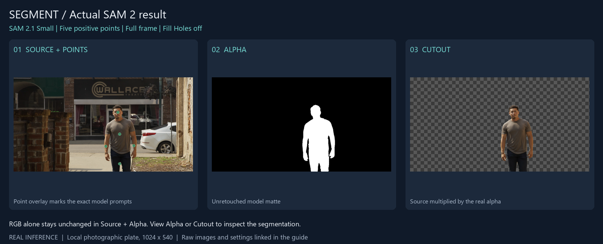

# Kyven Segment

[Documentation home](README.md) · [Nuke workflow](NUKE.md) · [Models](MODELS.md) ·
[Refine](REFINE.md) · [Troubleshooting](TROUBLESHOOTING.md)

**Kyven Segment is the main Kyven roto node.** It creates a binary alpha and a confidence trimap
from positive and negative Viewer points. It supports one frame, independent frame ranges, and
temporally consistent SAM 2 video tracking.



*Actual SAM 2.1 Small result. [Raw images and settings](EXAMPLES.md#segment) ·
[Input/settings/result walkthrough](NODES.md#segment) ·
[Captured Nuke controls](NODE_CONTROLS.md#segment).*

## On this page

- [Quick start](#quick-start)
- [Prompts](#prompts)
- [Current frame, range, or tracking](#choose-a-processing-mode)
- [Video tracking and corrections](#sam-2-video-tracking)
- [Seamless Key Frame](#seamless-key-frame)
- [Processing ROI](#processing-roi)
- [Mask cleanup and confidence](#mask-cleanup-and-confidence)
- [Outputs](#outputs)
- [Cache layout](#cache-layout)
- [CLI and technical pipeline](#cli)

## Quick start

1. Connect the plate or Source image.
2. Put a positive point inside the object.
3. Add negative points over unwanted areas.
4. Choose **Cache Folder**, enter **Roto Name**, and set **Version** such as `v001`.
5. Press **Process Current Frame**.
6. Leave **Output = Source + Alpha** for normal compositing, or choose **Alpha** to inspect the mask.

The first run loads the selected SAM model. Later frames and jobs reuse the resident provider until
another model family is selected or the server is stopped.

For an existing script, restart Nuke after updating Kyven and use **Kyven > Upgrade Selected Segment Node**. Hover over a control for its English explanation. See [input preparation](NUKE.md#input-preparation-and-processing) for caching and upstream edits.

## Inputs and controls

Segment has one Source input. Its main control groups are:

| Group | Purpose |
| --- | --- |
| **Model and Performance** | Select SAM 2 model and memory profile |
| **Positive Points** | Mark the object to keep |
| **Negative Points** | Remove nearby objects or background |
| **Processing ROI** | Limit the pixels sent to SAM |
| **Mask Post-Process** | Fill enclosed holes and build confidence trimap |
| **Independent Frame Processing** | Process one frame or every frame independently |
| **SAM 2 Video Tracking** | Propagate temporally from a key frame |
| **Output** | Choose alpha, cutout, trimap, or bypass |
| **Cache** | Choose the public destination and version |

Use **Model Manager...** to install a trusted catalog model. **Refresh Models** updates the list and
hardware advice after installation. See [Models and safety](MODELS.md) before choosing a heavier
checkpoint.

## Prompts

Positive points identify the object to keep. Negative points reject unwanted regions. Start with as
few points as possible, then add points only where the result is wrong.

- Each point is a Viewer handle and can be animated.
- Positive and negative point sets have independent enable controls.
- Removing a point shifts later rows while preserving their animation.
- The node supports up to 32 controls per point type.
- New points inherit saved key/correction frames so the tracking setup stays coherent.

Points are evaluated at the current frame for independent processing. During video tracking they
are sampled at the primary key and at every saved correction frame.

## Choose a processing mode

| Mode | How it works | Use it when |
| --- | --- | --- |
| **Process Current Frame** | Runs image segmentation at the playhead and replaces only that cached frame | Building or correcting a hero frame |
| **Process Frame Range** | Runs every selected frame independently with the animated prompts/ROI | Temporal consistency is unnecessary or tracking fails |
| **Forward / Backward / Both Directions** | Builds one SAM 2 video-memory state and propagates from the key | Normal roto sequences |
| **Live Current Frame** | Debounced asynchronous refresh while moving or editing | Fast prompt setup; disable before ranges/tracking |

Current Frame, Frame Range, and tracking all write the same public sequence. Processing one frame
after tracking no longer disconnects or replaces the sequence Read; it updates only that frame.

Only one operation can run per node. Repeated clicks do not create concurrent model copies. The
native progress window reports export/model stages, percentage, ETA, and cooperative cancellation.

## SAM 2 video tracking

1. Move to a clear frame where the object is easy to identify.
2. Place positive/negative points and optionally set a Processing ROI.
3. Click **Set Current as Key**.
4. Set **Range First** and **Range Last**.
5. Move to difficult later frames, adjust points, and click **+ Correction at Current Frame**.
6. Optionally enable **Seamless Key Frame**.
7. Run **Backward**, **Both Directions**, or **Forward**.

The primary key and every correction condition the same tracking state before propagation. Saved
corrections appear as frame rows. Editing a row's frame moves its point keyframes; removing the row
removes those correction keys. Changing the primary Key Frame similarly moves the primary point
keys rather than leaving hidden prompts behind.

The direction controls which part of the selected range is written. Corrections inside the range are
loaded into the state regardless of which direction button starts the job.

Nuke keeps high-quality JPEG inputs in the shared `_kyven_work/source/tracking_pool/`; tracking uses a temporary range view of that pool. Kyven
offloads video frames and tracking state to system RAM where supported, writes lossless full-size PNG
mattes, and preserves private SAM logits for confidence trimaps.

### Seamless Key Frame

SAM 2 treats the prompted key as a conditioning frame without temporal memory. The next propagated
frame can therefore look cleaner than the key even when the object barely moves.

When **Seamless Key Frame** is enabled, Kyven performs an optional cleanup after normal tracking:

1. Keep the loaded SAM 2 model and decoded video frames.
2. Clear only the first tracking-memory chain.
3. Use the nearest completed neighbour mask as a new mask prompt.
4. Propagate exactly one frame toward the primary key.
5. Replace only the primary key matte and logits.

With Both Directions, the next frame is preferred; at the end of a range, the previous frame is
used. A one-frame range is unchanged. The node Status reports the source frame, for example
`seamless key from 1052`.

The option is disabled by default because a neighbour containing motion blur, occlusion, or a
tracking error can produce a worse key. Compare the key with the option on and off for the shot.

## Processing ROI

Processing ROI is an inference crop, not a SAM box prompt and not an output crop:

```text
full Source -> crop to ROI -> translate points -> run SAM -> restore full-size mask
```

The final matte always keeps the Source dimensions. Positive points must be inside the ROI; negative
points outside it are ignored. Inverted corners are normalized, coordinates are clamped, and an
empty/outside ROI safely falls back to the full frame.

The ROI may be animated during tracking. Each frame is cropped separately and normalized to the
key-frame ROI size, then its matte is restored to that frame's original coordinates. Use an animated
ROI only when the object moves enough to need it; SAM already resizes inputs internally, so a smaller
ROI improves focus and effective detail but does not guarantee proportional VRAM savings.

## Mask cleanup and confidence

### Fill Enclosed Holes

**Fill Enclosed Holes** removes black islands completely surrounded by foreground. It never expands
the outer silhouette. **Max Hole Area (px)** limits the filled components; `0` means unlimited.
Changing these controls rebuilds an existing result from the private raw matte on CPU and does not
rerun SAM.

### Confidence Width

Kyven stores signed SAM logits as compressed float16 NPZ files and derives a three-state trimap:

```text
logit <= -T       confident background -> black
-T < logit < T    uncertain            -> gray
logit >= T        confident foreground -> white
```

**Confidence Width** controls `T`. Increasing it widens the uncertain band. Changing it regenerates
the cached trimap on CPU without loading SAM.

For a confidence-guided soft alpha:

```text
Source ----------------------------> Refine Source
Source -> Segment (Output: Edge Guide) -> Refine Mask
```

Disable **Generate Trimap from Mask** in Refine so ViTMatte receives SAM's actual uncertainty.

## Outputs

| Output | Result |
| --- | --- |
| **Source + Alpha** | Original Source RGB with generated mask in alpha; default |
| **Alpha** | Binary mask in RGB and alpha |
| **Cutout** | Source premultiplied by the generated alpha |
| **Source + Edge Guide** | Original RGB with edge guidance in alpha |
| **Edge Guide** | White: object; black: background; gray: uncertain pixels for Refine |
| **Bypass** | Unchanged Source |

Output switching uses native Nuke nodes and never reruns SAM.
**Edge Guide** is the clearer interface name for SAM's three-state confidence trimap.
Existing scripts keep the same output selection when the old labels are upgraded.

## Cache layout

Segment uses three artist fields:

```text
<Cache Folder>/
└── <Roto Name>/
    └── <Version>/
        ├── <Roto Name>_<Version>.1001.png
        ├── <Roto Name>_<Version>.1002.png
        └── _kyven_work/
            ├── source/
            ├── manifests/
            ├── raw_matte.1001.png
            ├── sam_logits.1001.npz
            └── confidence_trimap.1001.png
```

The version root is intentionally clean for artists and applications that do not use Kyven. Two
nodes with the same Folder, Roto Name, and Version deliberately read and write the same sequence.
Changing any field reconnects an existing matching sequence. **Create Matte Read** creates a normal
Read; **Delete Node Cache** removes only the selected Name/Version after confirmation.

## CLI

Example with one positive and one negative point:

```text
kyven segment \
  --input frame.png \
  --output matte.png \
  --model sam2.1-small \
  --models-dir models \
  --point 640,360,positive \
  --point 100,100,negative \
  --profile balanced
```

Box prompts use `--box X0,Y0,X1,Y1`. Device selection is `auto`, `cuda`, or `cpu`. On success the
CLI prints structured JSON with output, score, deterministic cache key, device, and provider
metadata. See [Server API](SERVER.md) for the host-neutral request fields.

## Technical pipeline

```text
Nuke / CLI adapter
      -> SegmentRequest
      -> SegmentService
      -> selected SAM 2 provider
      -> logits
           +-> binary alpha -> optional hole fill -> public PNG
           +-> confidence thresholds -> private trimap PNG
           +-> compressed float16 NPZ
```

The provider registry stores factories and constructs a provider only when selected. Importing
Kyven or starting Nuke does not import PyTorch, load SAM 2, or allocate VRAM. ROI participates in
deterministic cache identity. Successful outputs are written atomically and validated by manifests.

## Development

Create a Python 3.10+ environment and install the development package:

```text
python -m pip install -e ".[dev]"
python -m pytest -q
```

SAM 2 is an optional runtime. Kyven downloads weights from its trusted catalog and verifies exact
size and SHA-256. HQ-SAM 2.1 Large Beta keeps the same host contract but targets 12 GB+ GPUs.
